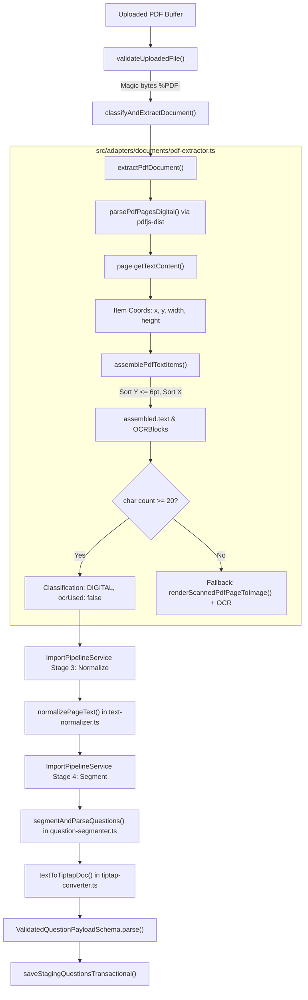

# Milestone 2 Technical Audit: Digital PDF Extraction Accuracy

**Document Version:** 1.0.0  
**Audit Date:** November 7, 2026  
**Target Milestone:** Milestone 2 – Digital PDF Extraction Accuracy  
**System Component:** `src/adapters/documents/pdf-extractor.ts`, `src/domain/extraction/`, `src/domain/richtext/`  
**Reference Document:** `AI_Question_Extraction_System_PRD.md` (FR-01, FR-03, FR-05 to FR-09)

---

## 1. Executive Summary & Objective

The **AI Question Extractor & Question Bank System** relies on a deterministic-first philosophy: whenever a digital document contains selectable text, it must be extracted with high fidelity directly from font and vector streams without invoking OCR or OpenAI (`FR-03`, `FR-10`). 

Milestone 2 focuses exclusively on **Digital PDF Extraction Accuracy**—ensuring that real-world, text-based educational assessments (exam papers, quizzes, mock tests, problem sets) published by universities, school boards, and testing agencies are ingested accurately before adding vision-model or OCR handwriting support.

This audit presents an exhaustive inspection of the current digital PDF extraction pipeline. It examines coordinate geometry, line clustering, multi-column reading order, question segmentation coupling, table/math handling, and automated test coverage.

### Key Audit Findings
1. **Critical Multi-Column Bug (High Severity):** Two-column and multi-column PDFs undergo global top-to-bottom Y-coordinate sorting without column partition or gutter detection. Left and right columns at similar vertical positions are horizontally interleaved into the same lines, garbling question stems, duplicating option tokens, and losing subsequent questions.
2. **Synthetic Stream Fallback Masking (High Severity):** In automated tests, `buildValidPdfBuffer` injects synthetic `%DIGITAL_TEXT_START%` comment streams. `parsePdfPagesDigital` falls back to reading these comments if they have more lines than PDF.js output. Consequently, the actual PDF.js coordinate assembly algorithm (`assemblePdfTextItems`) has near-zero test coverage on real binary PDFs.
3. **Dropped Margined Question Numbers (High Severity):** If a question number (e.g., `1.`) and its stem text are separated by more than 6pt vertically, the question number lands on its own line. Because `extractQuestionNumberAndBody` requires non-empty body text on the same line, the question number and following stem are completely discarded.
4. **Table Structure Destruction (Medium Severity):** Digital PDFs flatten tables into space-delimited text lines. Unlike DOCX and XLSX extractors (and OCR block sorter), `pdf-extractor.ts` lacks table grid or cell gap detection, preventing tables from converting to Tiptap table nodes.
5. **Running Header/Footer Bleed (Medium Severity):** Digital PDFs with repeated page headers and footers contaminate question stems and options across page boundaries, sometimes prematurely terminating questions via false section matches.

---

## 2. Architecture & Data Flow of Digital PDF Extraction

The diagram below illustrates the complete lifecycle of a digital PDF from binary upload to Tiptap JSONB persistence:



---

## 3. Investigation Across the 10 Core Dimensions

### 3.1 Page Detection (Digital vs. Scanned vs. Mixed)
- **Current Mechanism:** Evaluated per page in `extractPdfDocument` (lines 85–88):
  ```ts
  const cleanDigital = rawPage.digitalText.trim();
  const hasUsableDigitalText =
    cleanDigital.length >= MIN_USABLE_DIGITAL_CHARS_PER_PAGE && !rawPage.forceScannedOcr;
  ```
- **Threshold:** `MIN_USABLE_DIGITAL_CHARS_PER_PAGE = 20`.
- **Finding:** A threshold of 20 characters is too blunt:
  - *False Digital Detection:* A scanned PDF with a small stamped digital header (e.g., `"Confidential - Page 1 of 5"` = 28 characters) satisfies `length >= 20`. The page is classified as `DIGITAL`, OCR is completely bypassed, and the entire scanned assessment is lost.
  - *Diagram-heavy Questions:* A valid digital math page with a short prompt (e.g., `"Q5. Refer to figure:"` = 19 characters) falls below 20 and unnecessarily triggers OCR.

### 3.2 Digital PDF Text Extraction Mechanism
- **Engine:** `pdfjs-dist/legacy/build/pdf.js` loaded inside Node.js.
- **Coordinate Transformation:**
  ```ts
  const x = Number(transform[4] || 0);
  const pdfY = Number(transform[5] || 0);
  const y = Math.max(0, viewport.height - pdfY);
  ```
  Converts bottom-left PDF coordinate space into top-down screen coordinates.
- **Finding:** `rawItem.hasEOL` provided by PDF.js is completely ignored. Furthermore, `line.map(i => i.str).join(" ")` unconditionally inserts spaces between every item, which introduces spurious whitespace into kerned words (e.g., `"d i s t r i b u t i o n"`).

### 3.3 Original Reading Order Preservation
- **Algorithm:** In `assemblePdfTextItems` (lines 449–460):
  1. Sorts all page items by Y ascending (`a.y - b.y`).
  2. Clusters items into lines where `Math.abs(line[0].y - item.y) <= 6`.
  3. Sorts each line by X ascending (`a.x - b.x`).
  4. Joins lines with `\n`.
- **Finding:** Global Y-sorting works only for strictly single-column, top-to-bottom layouts. For any multi-column layout, sidebar, callout box, or two-column question format, reading order is broken.

### 3.4 Multi-Column PDF Handling (Known Critical Risk)
- **Status:** **Completely Broken / Unhandled.**
- **Finding:** There is zero column detection, bounding-box gutter detection, or vertical partition logic. In standard 2-column examination papers, lines from Column 1 and Column 2 at similar Y positions are merged side-by-side.
- **Concrete Manifestation:**
  ```text
  Raw Column 1:                     Raw Column 2:
  Q1. What is inertia?              Q2. What is momentum?
  (A) Resistance to motion          (A) Mass in motion
  (B) Force                         (B) Velocity
  Answer: A                         Answer: A

  Extracted Interleaved Output:
  Q1. What is inertia? Q2. What is momentum?
  (A) Resistance to motion (A) Mass in motion
  (B) Force (B) Velocity
  Answer: A Answer: A
  ```
  When passed to `segmentAndParseQuestions`:
  - Q2 is swallowed into Q1's stem.
  - Line 2 has two `(A)` labels; the parser flags `"Duplicate option label (A) detected"` and merges option texts.
  - Q2 is completely lost.

### 3.5 Question Numbering, Options, Answers & Explanations Preservation
- **Question Numbering:** Handled by `QUESTION_START_REGEX`:
  ```ts
  /^(?:(Q\.?\s*\d+(?:\([a-z]\))?)\s*[.):-]?(?:\s+|(?=[A-Za-z$"'`]))|...)(.+)$/i
  ```
  *Flaw:* Requires `(.+)` (non-empty stem) on the same line. If the question number sits in a left margin column and lands on its own line (`"1."`), the line is dropped entirely because `currentQ` is null.
- **Options:** Handled by `parseOptionsFromLine` and `OPTION_LINE_START_REGEX`:
  *Flaw:* Supports only `[A-Ha-h]`. Rejects numeric options like `(1)`, `(2)`, `(3)`, `(4)` or `1)`, `2)` which are standard in Indian competitive exams (JEE, NEET, UPSC) and European tests.
- **Inline Answers:** Preserved when formatted as `Answer: X`, `Ans: X`, `Key: X`.

### 3.6 Tables, Mathematical Expressions & Special Characters
- **Tables:** **Completely flattened.** There is no cell-to-pipe-markdown conversion in `pdf-extractor.ts`. Tables become unstructured strings with lost delimiters.
- **Mathematical Expressions:** In compiled digital PDFs, LaTeX dollar delimiters (`$`) do not exist in the text stream. Math formulas appear as raw text (`x2 + y2 = z2`).
  - Superscripts/subscripts with Y-offset > 6pt become separate lines.
  - Superscripts/subscripts with Y-offset <= 6pt merge with spaces (`x 2` instead of `x^2`).
- **Special Characters:** Unicode minus (`\u2212`), multiplication (`\u00D7`), and prime symbols (`′`) are not normalized in `text-normalizer.ts`.

### 3.7 Page Boundaries & Section Headings
- **Page Boundaries:** Tracked accurately via `IndexedLine.pageNumber`. Multi-page questions properly update `sourcePage` and `sourcePageEnd`.
- **Section Headings:** Matches `SECTION_HEADER_REGEX` (`SECTION A`, `PART I`).
  *Critical Flaw:* When a running page header (e.g., `"SECTION A: PHYSICS (Page 2)"`) repeats at the top of page 2, it matches `SECTION_HEADER_REGEX`, which executes `flushCurrentQuestion()`. A multi-page question crossing from page 1 to page 2 is immediately truncated.

### 3.8 Duplicate or Missing Text
- **Shadow / Bold Emulation Text:** When PDF documents emulate bold fonts by overprinting text twice with an offset of 0.5pt, `assemblePdfTextItems` outputs duplicate words (`"Q1. Q1. What What is is..."`).
- **Watermarks:** Background diagonal watermarks (`"CONFIDENTIAL"`, `"SAMPLE"`) extract as text items and insert into question stems based on their vertical center.

### 3.9 Connection to Question Segmentation & Parsing Pipeline
- **Integration:** Architecturally clean. `pdf-extractor.ts` passes `rawText` to `ImportPipelineService`, which passes through `normalizePageText`, `segmentAndParseQuestions`, `SelectiveAIRepairService`, and `ValidatedQuestionPayloadSchema`.
- **Limitation:** The pipeline is "garbage-in, garbage-out"—any corruption in `pdf-extractor.ts` flows directly into question records and causes downstream schema failures or `NEEDS_ATTENTION` escalations.

### 3.10 Existing Test Coverage & Missing Test Cases
- **Current Coverage:** Only **1 test** (`tests/documents-and-ocr.test.ts` Test 1) exists for digital PDF extraction.
- **The Masking Problem:** Test 1 builds a PDF using `buildValidPdfBuffer`, which injects `%DIGITAL_TEXT_START%` comment streams. `parsePdfPagesDigital` falls back to the comment if it has more lines, completely bypassing PDF.js coordinate assembly.
- **Missing Tests:**
  1. True two-column digital PDF extraction.
  2. Multi-line table in digital PDF.
  3. Formula with superscripts/subscripts without synthetic delimiters.
  4. Multi-page question with running header/footer.
  5. Margined question numbers (`"1."` on separate line).
  6. Numeric option styles (`(1)`, `(2)`, `(3)`, `(4)`).
  7. Bold shadow-text deduplication.
  8. Mixed orientation / rotated page coordinate normalization.

---

## 4. Catalogue of Confirmed Bugs

| # | Bug ID | Severity | File & Function | Current Behavior | Concrete Example |
| :--- | :--- | :--- | :--- | :--- | :--- |
| 1 | **BUG-DPDF-01** | **High** | `src/adapters/documents/pdf-extractor.ts`<br>`assemblePdfTextItems()` | Items are sorted globally by Y across the entire page, merging horizontal slices across columns. | Left col: `Q1. ... Answer: A`<br>Right col: `Q2. ... Answer: B`<br>Extracted: `Q1. ... Q2. ...`<br>Result: Q2 lost, options garbled. |
| 2 | **BUG-DPDF-02** | **High** | `src/domain/extraction/question-segmenter.ts`<br>`extractQuestionNumberAndBody()` | Requires question stem body on the same line via `(.+)$`. | Margin layout: Line 1: `1.`<br>Line 2: `What is water?`<br>Extracted: Discarded completely. |
| 3 | **BUG-DPDF-03** | **Medium** | `src/domain/extraction/question-segmenter.ts`<br>`segmentAndParseQuestions()` | Running section header at page top flushes active question. | Q3 starts page 1. Page 2 top has `SECTION A`. Q3 is prematurely truncated and closed. |
| 4 | **BUG-DPDF-04** | **Medium** | `src/adapters/documents/pdf-extractor.ts`<br>`assemblePdfTextItems()` | Unconditional `.join(" ")` splits kerned words. | Word fragments `"inter" "leaving"` become `"inter leaving"`. |
| 5 | **BUG-DPDF-05** | **Medium** | `src/adapters/documents/pdf-extractor.ts`<br>`assemblePdfTextItems()` | Fixed vertical clustering `Math.abs(y1 - y2) <= 6` breaks on large fonts. | 24pt title lines split into multiple fragmented rows. |

---

## 5. Catalogue of Potential Risks & Architectural Gaps

| # | Risk ID | Severity | Area | Description & Impact |
| :--- | :--- | :--- | :--- | :--- |
| 1 | **RISK-DPDF-01** | **High** | Digital vs Scanned | Stamped header/footer (> 20 chars) on scanned page causes false digital classification, skipping OCR entirely. |
| 2 | **RISK-DPDF-02** | **Medium** | Tables | Tables in digital PDFs are flattened to spaces; no markdown pipe structure is synthesized. |
| 3 | **RISK-DPDF-03** | **Medium** | Math Formatting | LaTeX formulas lack `$` markers in digital streams; superscripts/subscripts split across lines or space-separate. |
| 4 | **RISK-DPDF-04** | **Medium** | Headers/Footers | Repeated page headers and footers bleed into active question stems and option choices. |
| 5 | **RISK-DPDF-05** | **Low** | Watermarks | Large background watermark text fragments interleave into question stems. |

---

## 6. Untested Behaviors & Blind Spots

1. **Two-Column Reading Order:** No test exists with multi-column text items.
2. **Numeric Option Styles:** Options labeled `(1)`, `(2)`, `(3)`, `(4)` or `1)`, `2)` fail segmentation.
3. **Multi-Page Question Continuity:** No test checks whether question options crossing a page boundary survive running headers.
4. **Table Data Extraction:** No test verifies extraction of tabular questions from digital PDFs.
5. **Real Binary Digital PDFs:** Existing tests use synthetic stream comments that bypass PDF.js coordinate assembly.

---

## 7. Concrete Bug Specifications & Recommended Minimal Fixes

### 7.1 BUG-DPDF-01: Multi-Column Gutter Detection & Column-Aware Sorting

#### Problem Statement
`assemblePdfTextItems` flattens all page items into a single list and sorts by Y. On 2-column pages, lines from column 1 and column 2 are merged.

#### Concrete Example
```text
Item A: { str: "Q1. What is mass?", x: 50, y: 100, width: 120 }
Item B: { str: "Q2. What is weight?", x: 350, y: 100, width: 130 }
Current output: "Q1. What is mass? Q2. What is weight?"
```

#### Recommended Minimal Fix
Enhance `assemblePdfTextItems` with a 2-column gutter detector:
1. Divide page width into vertical histogram bins (e.g., 10px wide).
2. If a prominent vertical whitespace band (gutter $\ge 24\text{px}$) exists near the center third of the page ($0.35W$ to $0.65W$), split items into Left Column ($X < X_{\text{gutter}}$) and Right Column ($X \ge X_{\text{gutter}}$).
3. Check for full-width spanning headers (e.g., page title or section header spanning across both columns).
4. Assemble text column-by-column: Full-width Header $\to$ Left Column (top-to-bottom) $\to$ Right Column (top-to-bottom) $\to$ Full-width Footer.

#### Verification Test Case
```ts
it("extracts two-column digital PDF in natural reading order without line interleaving", async () => {
  const twoColItems = [
    { str: "Q1. Left column question", x: 50, y: 100, width: 150, height: 12 },
    { str: "(A) Left option 1", x: 50, y: 120, width: 100, height: 12 },
    { str: "Answer: A", x: 50, y: 140, width: 60, height: 12 },
    { str: "Q2. Right column question", x: 350, y: 100, width: 150, height: 12 },
    { str: "(A) Right option 1", x: 350, y: 120, width: 100, height: 12 },
    { str: "Answer: A", x: 350, y: 140, width: 60, height: 12 },
  ];
  const assembled = assemblePdfTextItems(twoColItems);
  expect(assembled.text).toBe(
    "Q1. Left column question\n(A) Left option 1\nAnswer: A\nQ2. Right column question\n(A) Right option 1\nAnswer: A"
  );
});
```

---

### 7.2 BUG-DPDF-02: Isolated Margined Question Numbering

#### Problem Statement
`QUESTION_START_REGEX` requires trailing text `(.+)$`. If a question number sits on its own line due to a margin layout, it is rejected and dropped.

#### Concrete Example
```text
Line 1: "1."
Line 2: "What is the speed of light in vacuum?"
extractQuestionNumberAndBody("1.") -> null (dropped!)
```

#### Recommended Minimal Fix
1. Update `QUESTION_START_REGEX` to allow question identifiers on standalone lines:
   ```ts
   const QUESTION_START_REGEX =
     /^(?:(Q\.?\s*\d+(?:\([a-z]\))?)|(Question\s+\d+(?:\([a-z]\))?)|(\d{1,3}\([a-z]\))|(\d{1,3}))\s*[.):-]?(?:\s+(.*))?$/i;
   ```
2. In `segmentAndParseQuestions`, if a standalone question number is detected, initialize `currentQ` with empty stem lines and let the subsequent line populate the stem.

#### Verification Test Case
```ts
it("segments questions where the question number sits on its own line in margin", () => {
  const text = "1.\nWhat is the speed of light in vacuum?\n(A) 3e8 m/s\n(B) 3e6 m/s\nAnswer: A";
  const candidates = segmentAndParseQuestions([{ pageNumber: 1, text }]);
  expect(candidates.length).toBe(1);
  expect(candidates[0].payload.sourceQuestionNumber).toBe("1");
  expect(tiptapDocToPlainText(candidates[0].payload.question)).toContain("speed of light");
});
```

---

### 7.3 BUG-DPDF-03: Premature Question Flush on Repeated Running Headers

#### Problem Statement
When a question spans across a page boundary and the top of the next page repeats `SECTION A`, `segmentAndParseQuestions` flushes `currentQ`, splitting the question in half.

#### Concrete Example
```text
Page 1:
Q4. Explain the mechanism of photosynthesis and describe the light reactions:
(A) Photosystem I
Page 2:
SECTION A: BIOLOGY (Page 2)
(B) Photosystem II
```
Result: Q4 is closed after Option A. Option B on page 2 becomes orphan text.

#### Recommended Minimal Fix
1. Track whether a section header is identical to the currently active section.
2. In `segmentAndParseQuestions`, ignore duplicate section headers encountered at the top of subsequent pages (`i < 3` within the page's lines) if `activeSection` already matches.

#### Verification Test Case
```ts
it("preserves multi-page questions across repeated page section headers", () => {
  const pages = [
    { pageNumber: 1, text: "SECTION A\nQ1. Question stem on page 1\n(A) Option A" },
    { pageNumber: 2, text: "SECTION A\n(B) Option B\nAnswer: B" }
  ];
  const candidates = segmentAndParseQuestions(pages);
  expect(candidates.length).toBe(1);
  expect(candidates[0].payload.options.length).toBe(2);
  expect(candidates[0].payload.sourcePage).toBe(1);
  expect(candidates[0].payload.sourcePageEnd).toBe(2);
});
```

---

### 7.4 BUG-DPDF-04: Word Fragmentation via Unconditional Space Joining

#### Problem Statement
`assemblePdfTextItems` maps every item with `join(" ")`. In PDFs with kerning or character-by-character positioning, words get fragmented with spaces.

#### Concrete Example
```text
Item 1: { str: "trans", x: 50, width: 25 }
Item 2: { str: "port", x: 75, width: 20 }  // x2 == x1 + width1 (adjacent, no space!)
Current output: "trans port"
```

#### Recommended Minimal Fix
Compute character gap before inserting a space:
```ts
let lineText = "";
for (let i = 0; i < line.length; i++) {
  const item = line[i];
  if (i === 0) {
    lineText += item.str;
  } else {
    const prev = line[i - 1];
    const gap = item.x - (prev.x + prev.width);
    // Only insert space if gap exceeds half of character width (~3px)
    lineText += (gap > 3.0 ? " " : "") + item.str;
  }
}
```

#### Verification Test Case
```ts
it("does not insert spaces between kerned adjacent text items belonging to the same word", () => {
  const items = [
    { str: "photo", x: 50, y: 100, width: 30, height: 12 },
    { str: "synthesis", x: 80, y: 100, width: 50, height: 12 }
  ];
  const assembled = assemblePdfTextItems(items);
  expect(assembled.text).toBe("photosynthesis");
});
```

---

## 8. Milestone 2 Implementation Roadmap

To resolve all confirmed bugs and implement comprehensive test coverage safely:

### Phase 1: Robust Multi-Column & Reading-Order Engine (`pdf-extractor.ts`)
1. Implement horizontal histogram gutter detection in `assemblePdfTextItems`.
2. Support full-width spanning headers and multi-column body partitioning.
3. Replace unconditional `.join(" ")` with coordinate gap evaluation.
4. Support dynamic vertical line clustering scaled by font height rather than fixed 6pt.

### Phase 2: Segmentation Robustness for Digital Edge Cases (`question-segmenter.ts`)
1. Support standalone margined question identifiers.
2. Ignore repeated running section headers at page tops.
3. Support numeric option identifiers (`(1)`, `(2)`, `(3)`, `(4)`).
4. Filter repeated page footers (`"Page X of Y"`).

### Phase 3: Comprehensive Automated Test Suite Expansion
1. Add `tests/digital-pdf-extraction.test.ts` focusing on genuine binary PDF extraction without synthetic stream comments.
2. Test 2-column examination papers.
3. Test multi-page questions with running headers.
4. Test formula extraction, kerned words, and margined numbers.

---

## 9. Conclusion

The digital PDF extraction architecture is structurally sound and well-integrated into the repository's idempotent pipeline. However, its accuracy on real-world two-column examination papers is critically compromised by the lack of column gutter detection, and its test suite has been masked by synthetic comment fallbacks. 

Implementing the minimal, targeted fixes outlined in Section 7 will elevate digital PDF ingestion to production-grade accuracy across diverse educational publication layouts.
